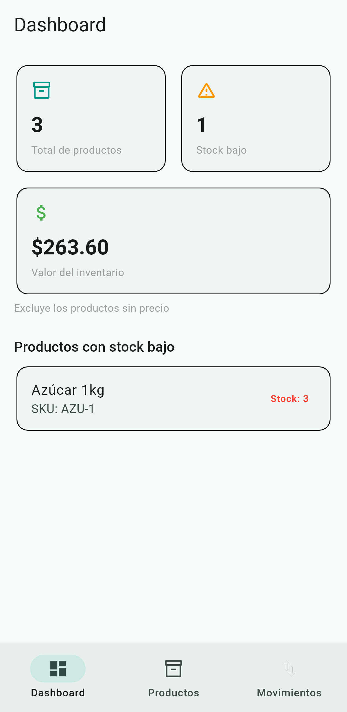
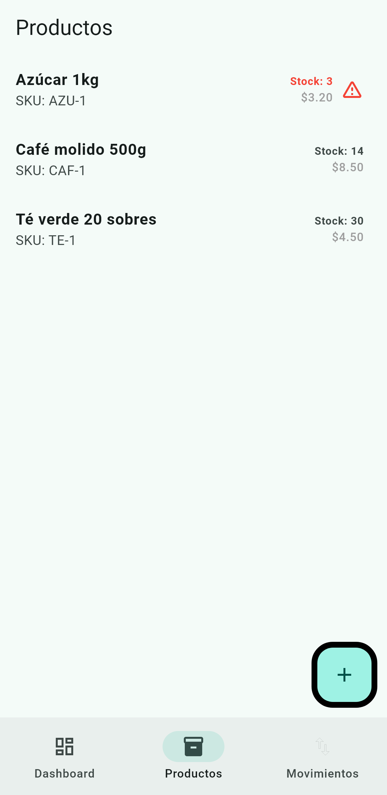
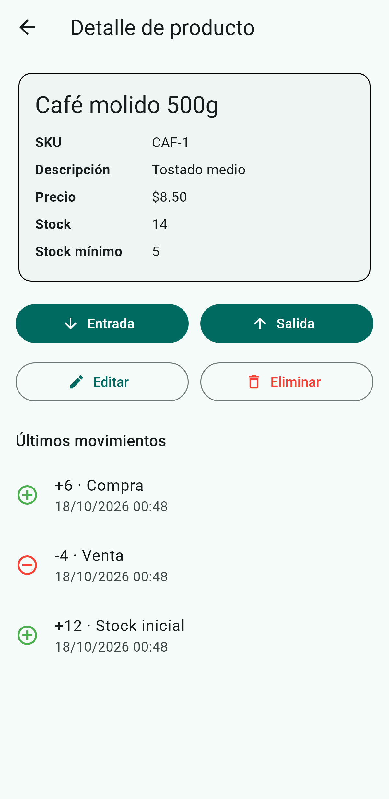
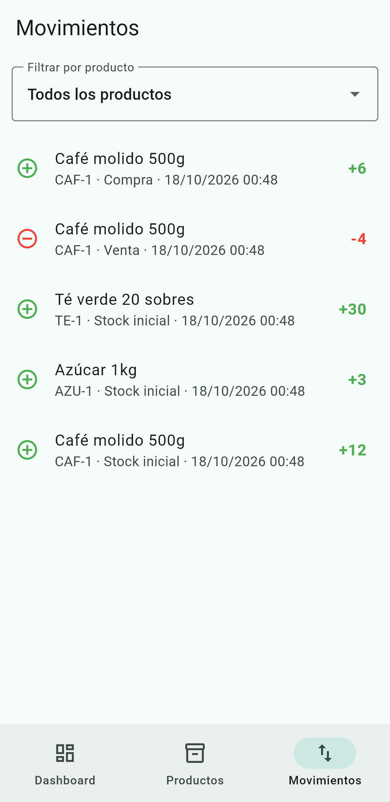

# StockFlow

Aplicación de inventario **offline** para Android hecha en Flutter. Permite
gestionar productos, registrar entradas y salidas de stock y consultar el
historial y un panel de resumen. Todos los datos se guardan localmente en el
dispositivo, por lo que la app funciona sin conexión a internet.

## Características

- **Dashboard** con total de productos, productos con stock bajo y valor del
  inventario (excluye los productos sin precio).
- **Productos**: alta, edición y borrado, con lista en vivo e indicador de stock
  bajo. El stock solo cambia mediante movimientos.
- **Detalle de producto** con datos, stock, últimos movimientos y acciones de
  Entrada, Salida, Editar y Eliminar.
- **Movimientos**: entradas y salidas con motivo obligatorio de lista fija,
  actualización transaccional del stock y validación de stock insuficiente.
- **Historial** descendente con producto, tipo, cantidad con signo, motivo y
  fecha, con filtro por producto.

## Capturas

| Dashboard | Productos |
|---|---|
|  |  |

| Detalle de producto | Movimientos |
|---|---|
|  |  |

## Cómo ejecutar

Requisitos:

- Flutter (canal stable) con el SDK de Android configurado.
- Un dispositivo o emulador Android.

Pasos:

```bash
flutter pub get
flutter run            # ejecuta la app en el dispositivo conectado
```

Pruebas y análisis estático:

```bash
flutter analyze
flutter test
```

Compilar el APK de release:

```bash
flutter build apk --release
# Salida: build/app/outputs/flutter-apk/app-release.apk
```

> Nota: `flutter test` usa una base de datos SQLite en memoria, por lo que la
> máquina necesita SQLite disponible (en Windows, la DLL de `sqlite3`).

## Decisiones técnicas

- **Plataforma:** Android (iOS opcional). Sin web ni escritorio.
- **Estado:** `flutter_riverpod` para providers, sin generación de código. Los
  providers son sobrescribibles en pruebas (se inyecta una base en memoria).
- **Persistencia:** `drift` / `drift_flutter` sobre SQLite, con archivo en el
  dispositivo y constructor en memoria para tests.
- **Formato:** `intl` para fechas y moneda.
- **Navegación:** `Navigator` nativo (3 pestañas con `NavigationBar` y un
  `IndexedStack` que conserva el estado). Se descartó GoRouter por simplicidad.
- **Estructura:** feature-first (`core/` y `features/{products,movements,dashboard}`),
  sin capa de dominio. Las clases generadas por Drift se usan como modelos y los
  repositorios contienen las reglas.
- **Stock:** vive en el producto y se actualiza junto con el movimiento dentro de
  una transacción. Los movimientos son inmutables; las correcciones se hacen con
  un movimiento nuevo.
- **Cantidades y precios:** enteros, y el precio en centavos. Una sola moneda.
- **Motivo:** obligatorio y de lista fija (`Stock inicial`, `Compra`,
  `Devolución`, `Ajuste`, `Venta`, `Merma`), cada uno asociado a un tipo.
- **Errores de negocio:** excepciones tipadas (`DuplicateSkuException`,
  `InsufficientStockException`, `ProductHasMovementsException`, ...) que la UI
  traduce a mensajes en español.
- **Pruebas:** repositorios contra Drift en memoria (que es el núcleo) y widget
  tests en formularios y bloqueos clave. Se descartó `mocktail`.

## Reglas de negocio destacadas

- El SKU se normaliza (trim y mayúsculas) y es único.
- El stock nunca queda negativo.
- Un producto se puede eliminar si no tiene movimientos o si su **único**
  movimiento es el de stock inicial (se borran juntos en una transacción). Con
  otros movimientos, el borrado se bloquea y se explica el motivo.
- Una salida mayor que el stock disponible se rechaza mostrando
  `Stock disponible: N`.

## Estructura del proyecto

```
lib/
  core/
    database/        # tablas, enums, AppDatabase y provider
    app_shell.dart   # navegación de 3 pestañas
    providers.dart   # providers de Riverpod
  features/
    products/        # lista, formulario y detalle
    movements/       # formulario, historial y repositorio
    dashboard/       # pantalla y consultas reactivas
test/                # pruebas unitarias y de widgets
docs/screenshots/    # capturas de la app
```

## Validación

- `flutter analyze` sin incidencias.
- `flutter test` sin fallos.
- `flutter build apk --release` genera un APK funcional.
